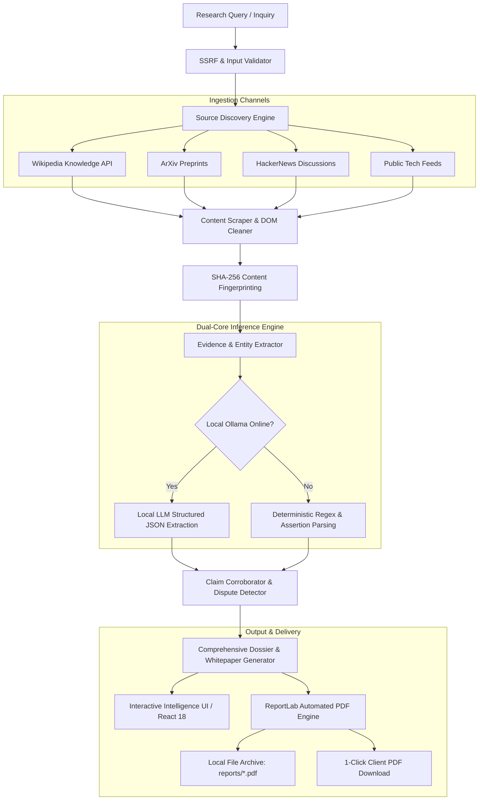

<div align="center">

#  RED THREAD

### **Autonomous OSINT Intelligence, Knowledge Synthesis & Research Engine**

*Every story leaves a trail. Connect the dots across fragmented public data with zero-cost deterministic inference.*

[](https://opensource.org/licenses/MIT)
[](https://www.python.org/)
[](https://www.djangoproject.com/)
[](https://react.dev/)
[](https://www.typescriptlang.org/)
[](https://github.com)

---

</div>

## 📌 Executive Abstract

**RED THREAD** is an enterprise-grade, privacy-first **Open Source Intelligence (OSINT)** and **Automated Research Platform**. It orchestrates multi-source ingestion pipelines, heuristic entity-relationship graphs, and deterministic LLM inference to transform ambiguous queries into comprehensive, publication-grade intelligence dossiers and multi-page research whitepapers.

Designed from first principles to operate **without recurring third-party API costs or cloud token billing**, RED THREAD couples local high-throughput Large Language Models (via **Ollama**) with a robust fallback pipeline: heuristic entity extraction, assertion verification, and automated cryptographic source hashing.

---

## ⚡ Core Capabilities & Architectural Highlights

### 1. 🔄 Multi-Channel Asynchronous Ingestion Pipelines
- **Federated Ingestion**: Concurrently crawls and ingests structured disclosures from **Wikipedia Open Knowledge APIs**, **HackerNews Algolia indices**, **ArXiv Academic Repositories**, and public syndication feeds.
- **SSRF & Ingestion Guard**: Hardened socket-level verification blocking private RFC-1918 subnets, cloud metadata targets (`169.254.169.254`), loopbacks, and protocol tampering.
- **Cryptographic Content Auditing**: SHA-256 fingerprinting on every ingested extract to guarantee tamper-proof audit trails and detect document drift across re-runs.

### 2. 🧠 Dual-Mode Intelligence Synthesis: Local LLM + Deterministic Engine
- **Local Frontier LLM Inference**: Direct zero-latency integration with local reasoning models (`llama3`, `deepseek-r1`, `mistral`, `qwen`) via local Ollama instances.
- **Deterministic Knowledge Fallback**: When offline or in constrained cloud environments, RED THREAD dynamically activates a deterministic rule-based synthesis engine, ensuring 100% operational uptime without paid API keys.
- **Anti-Hallucination Citation Binding**: Strict verification requiring all asserted claims to cite concrete, traceable tokens (e.g. `[S1]`, `[S2]`) directly matching ingested source registries.

### 3. 📑 2–3 Page Academic Research Paper Dossiers
- Generates thorough, multi-section whitepapers structured according to intelligence community standards:
  - **Foundational Orientation & First-Principles Primer**: Plain-English breakdown of core mechanics, historical genesis, and glossary of concepts.
  - **Verified Empirical Claims**: High-confidence assertions evaluated for corroboration and single-source dependencies.
  - **Figure 1: Cognitive Execution & Inference Pipeline**: Visual schematic flowcharts of model and compute pipelines.
  - **Table 1: Comparative Evaluation Matrix**: Standardized cross-model benchmarking (architecture, parameter counts, estimated training compute, openness).
  - **Contradictions & Competing Narratives**: Explicit flagging of disputes, regulatory controversies, and data distillation allegations.
  - **Critical Intelligence Gaps**: Concrete unresolved questions and next investigative vectors.

### 4. 🔍 Interactive In-Dossier Question & Topic Navigator
- **Client-Side Semantic Search**: Instant keyword and semantic intent indexing across the entire multi-page report without triggering external API calls.
- **Pinpoint Answer Extraction**: Pinpoints the exact responsive paragraph, extracts a concise contextual answer, and features **"Jump to Section"** with smooth-scroll and radiant red pulse highlighting (`.highlight-target`).

### 5. 📄 Automated Publication-Grade PDF Generator
- **ReportLab Native Engine**: Built-in PDF publishing engine formatting dossiers with cover banners, metadata blocks, styled multi-column tables, running headers, and page numbering (*"Page X of Y"*).
- **Automated Local Archival**: Every generated PDF is immediately archived to the local `reports/` directory on disk while simultaneously served for 1-click browser download.

---

## 🏗️ System Architecture Pipeline



---

## 💻 Tech Stack

| Domain | Technology | Description |
| :--- | :--- | :--- |
| **Backend Framework** | Django 5.1 & Django REST Framework | Enterprise Python API with transactional reliability |
| **Frontend Framework**| React 18 + TypeScript + Vite | Ultra-low latency single-page application with modern UI |
| **Design System** | Tailored Modern Vanilla CSS | Cyber-industrial dark aesthetic, glassmorphism, pulse animations |
| **LLM & Inference** | Ollama Local Engine (`llama3`, `deepseek-r1`) | Local zero-cost neural inference pipeline |
| **Document Publishing**| ReportLab 5.0 | Two-pass publication-grade PDF generation with running headers |
| **Data Ingestion** | HTTPX, BeautifulSoup4, Feedparser | Concurrent web extractors with strict socket-level SSRF filters |
| **Database** | SQLite3 (Local) / PostgreSQL (Cloud) | Dual-mode relational persistence with zero `blank=True` violations |

---

## 🚀 Quickstart Guide

### Prerequisites
- **Python 3.11+** installed
- **Node.js 18+** & **npm** installed
- *(Optional)* [Ollama](https://ollama.com/) running locally for neural LLM inference (`ollama run llama3`)

### 1. Clone & Set Up Backend

```bash
# Clone the repository
git clone https://github.com/your-username/red-thread.git
cd red-thread

# Create and activate virtual environment
python -m venv .venv
# Windows:
.venv\Scripts\activate
# Linux/macOS:
source .venv/bin/activate

# Install dependencies
pip install -r requirements.txt

# Run migrations
cd backend
python manage.py migrate

# Start Django Development Server (Runs on http://127.0.0.1:8000)
python manage.py runserver 127.0.0.1:8000
```

### 2. Set Up Frontend

```bash
# In a new terminal, navigate to the frontend directory
cd frontend

# Install dependencies
npm install

# Start Vite Development Server (Runs on http://127.0.0.1:5173)
npm run dev
```

Open your browser and navigate to **`http://127.0.0.1:5173/`**.

---

## 📁 Repository Structure

```
red-thread/
├── backend/                         # Django REST Framework Service
│   ├── investigations/              # Core Intelligence App
│   │   ├── models.py                # Data Models (Zero blank=True compliance)
│   │   ├── views.py                 # API ViewSets & PDF Export endpoints
│   │   ├── serializers.py           # REST Serializers
│   │   └── services/                # Modular Engine Services
│   │       ├── ai_provider.py       # Ollama LLM Connector & Health Monitoring
│   │       ├── claim_analyzer.py    # Claim Corroboration & Dispute Engine
│   │       ├── evidence_extractor.py# Entity, Relationship & Claim Parser
│   │       ├── pdf_generator.py     # ReportLab Multi-Page PDF Generation
│   │       ├── report_generator.py  # 2-3 Page Academic Whitepaper Synthesizer
│   │       ├── research_pipeline.py # Orchestrator for Multi-Step Inquiries
│   │       ├── source_discovery.py  # Multi-Channel Source Discovery Engine
│   │       └── ssrf_guard.py        # Socket-Level Network Safety Guard
│   ├── redthread_core/              # Django Project Config & Settings
│   └── requirements.txt             # Backend Dependencies
├── frontend/                        # React 18 TypeScript Client
│   ├── src/
│   │   ├── components/
│   │   │   ├── ResearchReportView.tsx # Whitepaper, Stats & Follow-up Navigator
│   │   │   ├── EvidenceExplorer.tsx   # Evidence & Claims Matrix
│   │   │   ├── EntityNetworkView.tsx  # Interactive Entity Relationship Graph
│   │   │   ├── TimelineView.tsx       # Chronological Event Timeline
│   │   │   └── CommandBar.tsx         # Quick Investigation Launcher
│   │   ├── App.tsx                  # Root View Controller
│   │   └── index.css                # Custom Cyber-Industrial Design System
│   └── package.json                 # Frontend Dependencies & Scripts
├── reports/                         # Local Directory for Generated PDF Dossiers
├── Procfile                         # Railway / Production Process Definition
├── requirements.txt                 # Root Deployment Requirements
└── README.md                        # Documentation
```

---

## 🔒 Security & Privacy Principles

1. **Air-Gapped & Zero-Cost Capable**: Never leaks your research questions or sensitive entities to external paid APIs (OpenAI, Anthropic, or cloud endpoints). All synthesis runs on your machine.
2. **SSRF Hardened**: Outbound web ingestion actively resolves DNS and inspects IP addresses prior to connection, neutralizing server-side request forgery vectors against internal network resources.
3. **Deterministic Integrity**: Every claim is verifiable. If a source cannot corroborate an assertion, it is tagged as `SINGLE_SOURCE` or `DISPUTED`.


<div align="center">

**RED THREAD** - *Precision Intelligence for Complex Domains.*

</div>
